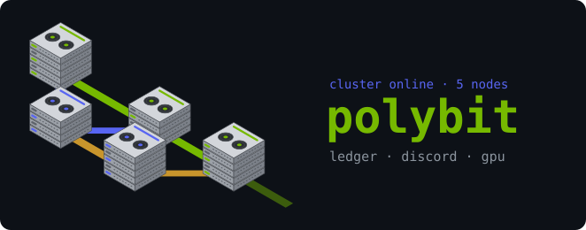

<p align="center">
  
</p>

<p align="center">
  <a href="https://discord.com/developers/docs/intro"></a>
  
  
  
  
</p>

Discord bot with its own coin, PB. Every transfer is a balanced journal entry,
append-only, checked by the database. Plug the rest in as extensions.

```
$ polybit audit
Journal entries: 18,204   Accounts: 1,311
Issued: 412,900   Burned: 1,250   In wallets: 398,410   Treasury: 13,240   Escrow: 0
OK: all ledger invariants hold.
```

## Run

```sh
cp .env.example .env    # bot token, admin IDs
docker compose up -d
```

## Extend

```sh
PB_EXTENSIONS=my_ext
```

```python
MIGRATIONS = "my_ext.migrations"   # .sql files, run once

def policy(settings):              # your rules, see polybit/policy.py
    return MyPolicy()

async def setup(bot):              # cogs, routes on bot.http_app
    await bot.add_cog(MyCog(bot))
```

## Commands

`/getbalance` `/send` `/sendmany` `/mine` `/leaderboard` `/getinfo` `/pbadmin`

## Dev

```sh
pip install -e ".[dev]"
sh scripts/security/install-hooks.sh
pytest
```

[SECURITY.md](SECURITY.md)
