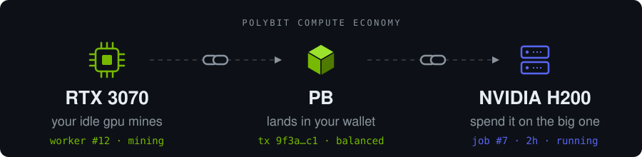

<p align="center">
  
</p>

<p align="center">
  
  
  
  <a href="https://discord.com/developers/docs/intro"></a>
  
</p>

<p align="center"><b>Mine PB on your GPUs. Spend it on compute you don't own. Settled on-ledger, inside Discord.</b></p>

<p align="center">
  
</p>

## Spec

| Coin | PB, 6 decimals |
|---|---|
| Mining | GPU compute + daily `/mine` |
| Settlement | double-entry, append-only, balanced in the DB |
| Integrity | every tx SHA-256 hashed, `polybit audit` recomputes all |
| Supply | minted on rewards, burnable, fully auditable |
| Network | Discord slash commands |

This repo is the node: bot + ledger. Rigs and the GPU market plug in as extensions.

## Run a node

```sh
# .env: PB_DISCORD_TOKEN, PB_ADMIN_IDS, PB_DB_PASSWORD (all settings in polybit/config.py)
docker compose up -d
```

## Wallet

`/getbalance` `/send` `/sendmany` `/mine` `/leaderboard` `/getinfo` `/pbadmin`

## Audit

```
$ polybit audit
Journal entries: 18,204   Accounts: 1,311
Issued: 412,900   Burned: 1,250   In wallets: 398,410   Treasury: 13,240   Escrow: 0
OK: all ledger invariants hold.
```

## Extensions

```python
# PB_EXTENSIONS=my_ext
MIGRATIONS = "my_ext.migrations"   # .sql, run once

def policy(settings):              # your rules, see polybit/policy.py
    return MyPolicy()

async def setup(bot):              # cogs, routes on bot.http_app
    await bot.add_cog(MyCog(bot))
```

## Dev

```sh
pip install -e ".[dev]"
sh scripts/security/install-hooks.sh
pytest
```

[SECURITY.md](SECURITY.md)
